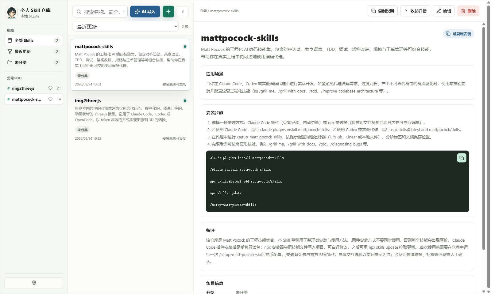
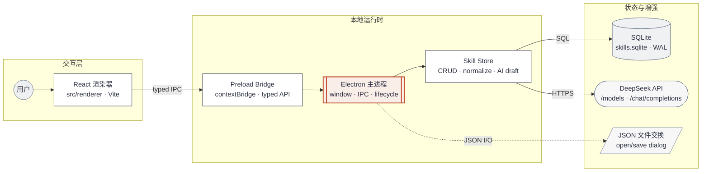

# SkillCore

SkillCore 是一个 Windows 优先的本地个人 Skill 仓库桌面应用，用来收藏、整理和维护常用 Skill 条目。每个条目聚焦于简短介绍、适用场景、标签、来源链接、安装步骤和可复制的安装命令。



## 当前能力

- 三栏工具型界面：左侧导航和标签，中间搜索列表，右侧 AI 导入、详情、编辑和设置工作区。
- AI 导入：粘贴 Skill 下载网址或资料网址后生成可编辑草稿，用户确认后才保存为 Skill。
- DeepSeek 模型设置：支持配置 API Base URL、模型名、API Key，并测试连接。
- ZIP 导入：选择单个 Skill 压缩包，按 Agent Skills 规范校验后自动保存；格式错误会显示具体原因。
- 条目维护：支持编辑、删除、搜索、筛选、排序和查看 Skill 条目。
- 安装信息管理：展示安装步骤，复制安装命令或完整安装说明。
- JSON 导入导出：导入时支持覆盖、跳过、另存为新条目三种同名冲突处理方式。
- 本地存储：数据保存在 Electron `userData` 目录下的 SQLite 数据库中。

## V1 边界

SkillCore 是个人知识仓库，不是自动化安装器或公开市场。当前版本不包含：

- 一键执行安装命令。
- 自动扫描本机 Skill 目录。
- 在线账号、多设备同步或远程 Skill 市场。
- 评分、评论、下载量等公开市场功能。

## Skill ZIP 导入

原“手动新建”入口已替换为“导入 Skill ZIP”。选择 `.zip` 后，应用在本地解析并自动保存，无需配置模型。

支持两种结构：`skill-name/SKILL.md`，或 `SKILL.md` 直接位于 ZIP 根目录。压缩包只能包含一个 Skill；有 Skill 目录时，目录名必须与 `name` 一致，其附件应位于该目录内。忽略 macOS 的 `__MACOSX/` 和 `.DS_Store` 元数据。

`SKILL.md` 必须使用 UTF-8 编码，并以 YAML 元数据开头：

```markdown
---
name: my-skill
description: 说明技能的功能和适用时机。
---

# 使用说明

这里编写 Skill 的 Markdown 正文。
```

核心字段校验依据是 [Agent Skills 官方规范](https://agentskills.io/specification)和[官方参考校验器](https://github.com/agentskills/agentskills/blob/main/skills-ref/src/skills_ref/validator.py)，同时兼容 [Claude Code 的 Skill 元数据扩展](https://code.claude.com/docs/en/skills#frontmatter-reference)：

- `name` 为非空字符串，最多 64 个字符，支持 Unicode 字母和数字，字母须小写；允许连字符，但不能以连字符开头或结尾，也不能连续出现。
- `description` 为非空字符串，最多 1024 个字符。
- `license`、`compatibility` 校验字符串类型，`compatibility` 为 1–500 字符，`metadata` 必须是字符串键值映射；`allowed-tools` 支持字符串或 YAML 字符串列表。
- 允许 `argument-hint`、`disable-model-invocation`、`user-invocable`、`context`、`agent` 等扩展字段，以及其他附加元数据，不要求把它们移动到 `metadata`。`argument-hint` 校验字符串类型。扩展信息完整保留在原始 ZIP 中；导入不会执行这些配置。这是本地仓库的兼容导入规则，不保证原包能直接通过 claude.ai 或 Skills API 的严格上传校验。
- YAML 必须合法，不允许重复字段；Markdown 正文保留原文。推荐章节和 500 行建议不作为拒绝导入条件。
- 附件可以包含 `scripts/`、`references/`、`assets/` 或其他文件；导入过程不执行附件或安装命令。

应用限制：ZIP 最大 20 MB，解压内容最大 100 MB，`SKILL.md` 最大 1 MB，最多 2000 个文件或目录。不支持加密 ZIP、符号链接、重复路径和异常路径。所有文件都会检查大小及 CRC 校验值。

缺少文件、元数据不符合规范、目录名不匹配、多 Skill 或损坏压缩包时，会在导入面板持续显示中文错误，失败不会创建条目。同名条目会提示冲突，不自动覆盖。

名称和简介分别来自 `name`、`description`，完整正文显示在详情的“Skill 正文”。原始 ZIP（含全部附件）与条目一起存入 SQLite，可在详情点击“导出原始 ZIP”；编辑条目不修改原包，删除条目时也删除保存的原包。JSON 导出只包含条目信息，不包含 ZIP 二进制附件；需要附件时请单独导出原始 ZIP。

## 环境要求

- Windows。
- Node.js 和 npm。

## 本地开发

安装依赖：

```powershell
npm ci
```

启动开发环境：

```powershell
npm run dev
```

构建后启动桌面应用：

```powershell
npm run start
```

## 验证命令

在项目根目录执行验证命令：

```powershell
npm test
npm run typecheck
npm run build
npm run smoke
npm run test:archive-ui
```

本次详情页左侧“常用Skill”显示问题对应的专项回归测试是：

```powershell
npm test -- tests/detail-sidebar-layout.test.ts
```

`npm run smoke` 会以无窗口模式启动 Electron，并在渲染进程就绪后输出 `skill-repository-gui:smoke-ready`。

`npm run test:archive-ui` 使用隔离的临时数据库和隐藏的 Electron 窗口，验证 ZIP 校验提示、取消、自动保存、同名冲突、原包导出、重启持久化和删除，不使用个人数据库。

需要手动查看界面时，先运行：

```powershell
npm run dev
```

在打开的桌面窗口中点击任意 Skill 进入详情页，左侧导航仍应显示“常用Skill”和常用条目。

## Windows 打包

```powershell
npm run package:win
```

打包产物输出到 `release/`，当前配置会生成 NSIS 安装包和 Portable 可执行文件：

- `个人 Skill 仓库-Setup-0.1.0-x64.exe`
- `个人 Skill 仓库-Portable-0.1.0-x64.exe`

版本号来自 `package.json`。

## AI 导入说明

AI 导入当前固定使用 DeepSeek。首次使用前需要在应用内的模型设置中保存 API Key。默认 API Base URL 为：

```text
https://api.deepseek.com
```

默认模型为：

```text
deepseek-v4-flash
```

导入时可以关闭“允许应用联网抓取资料内容”。关闭后，应用只会把用户提供的网址和补充要求发送给模型生成草稿；开启后，会先抓取资料内容再调用模型解析。

## 数据位置

应用数据保存在 Electron 的 `userData` 目录下，数据库文件名为：

```text
skills.sqlite
```

数据库包含 Skill 条目和模型配置。应用界面只显示 API Key 的脱敏状态。

## 项目结构

```text
electron/     Electron 主进程和 preload
src/main/     SQLite 数据层和 AI 导入逻辑
src/shared/   主进程与渲染进程共享类型和 IPC 通道
src/renderer/ React 渲染界面
tests/        Vitest 测试
docs/prd/     产品与 GUI 设计文档
prototype/    静态 GUI 原型和截图
build/        应用图标资源
```

## 系统架构

SkillCore 采用 Electron 桌面架构：React 渲染器负责界面交互，通过 preload 暴露的 IPC API 调用 Electron 主进程；主进程把 Skill 数据交给 SQLite 持久化，并按需访问本地 JSON 文件和 DeepSeek API。



完整的可独立打开版本见：[SkillCore 架构图](docs/skillcore-architecture.html)。

## 相关文档

- [GUI 设计稿](docs/prd/skill-repository-gui-design.md)
- [静态原型](prototype/skill-repository-gui.html)
