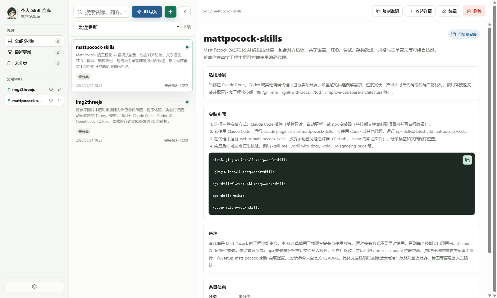
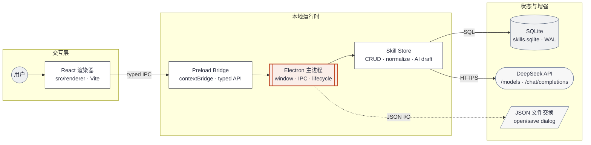

# SkillCore

SkillCore 是一个 Windows 优先的本地个人 Skill 仓库桌面应用，用来收藏、整理和维护常用 Skill 条目。每个条目聚焦于简短介绍、适用场景、标签、来源链接、安装步骤和可复制的安装命令。



## 当前能力

- 三栏工具型界面：左侧导航和标签，中间搜索列表，右侧 AI 导入、详情、编辑和设置工作区。
- AI 导入：粘贴 Skill 下载网址或资料网址后生成可编辑草稿，用户确认后才保存为 Skill。
- DeepSeek 模型设置：支持配置 API Base URL、模型名、API Key，并测试连接。
- 手动维护：支持新建、编辑、删除、搜索、筛选、排序和查看 Skill 条目。
- 安装信息管理：展示安装步骤，复制安装命令或完整安装说明。
- JSON 导入导出：导入时支持覆盖、跳过、另存为新条目三种同名冲突处理方式。
- 本地存储：数据保存在 Electron `userData` 目录下的 SQLite 数据库中。

## V1 边界

SkillCore 是个人知识仓库，不是自动化安装器或公开市场。当前版本不包含：

- 一键执行安装命令。
- 自动扫描本机 Skill 目录。
- 在线账号、多设备同步或远程 Skill 市场。
- 评分、评论、下载量等公开市场功能。

## 环境要求

- Windows。
- Node.js 和 npm。

## 本地开发

安装依赖：

```powershell
npm ci
```

启动开发环境：

```powershell
npm run dev
```

构建后启动桌面应用：

```powershell
npm run start
```

## 验证命令

在项目根目录执行验证命令：

```powershell
npm test
npm run typecheck
npm run build
npm run smoke
```

本次详情页左侧“常用Skill”显示问题对应的专项回归测试是：

```powershell
npm test -- tests/detail-sidebar-layout.test.ts
```

`npm run smoke` 会以无窗口模式启动 Electron，并在渲染进程就绪后输出 `skill-repository-gui:smoke-ready`。

需要手动查看界面时，先运行：

```powershell
npm run dev
```

在打开的桌面窗口中点击任意 Skill 进入详情页，左侧导航仍应显示“常用Skill”和常用条目。

## Windows 打包

```powershell
npm run package:win
```

打包产物输出到 `release/`，当前配置会生成 NSIS 安装包和 Portable 可执行文件：

- `个人 Skill 仓库-Setup-0.1.0-x64.exe`
- `个人 Skill 仓库-Portable-0.1.0-x64.exe`

版本号来自 `package.json`。

## AI 导入说明

AI 导入当前固定使用 DeepSeek。首次使用前需要在应用内的模型设置中保存 API Key。默认 API Base URL 为：

```text
https://api.deepseek.com
```

默认模型为：

```text
deepseek-v4-flash
```

导入时可以关闭“允许应用联网抓取资料内容”。关闭后，应用只会把用户提供的网址和补充要求发送给模型生成草稿；开启后，会先抓取资料内容再调用模型解析。

## 数据位置

应用数据保存在 Electron 的 `userData` 目录下，数据库文件名为：

```text
skills.sqlite
```

数据库包含 Skill 条目和模型配置。应用界面只显示 API Key 的脱敏状态。

## 项目结构

```text
electron/     Electron 主进程和 preload
src/main/     SQLite 数据层和 AI 导入逻辑
src/shared/   主进程与渲染进程共享类型和 IPC 通道
src/renderer/ React 渲染界面
tests/        Vitest 测试
docs/prd/     产品与 GUI 设计文档
prototype/    静态 GUI 原型和截图
build/        应用图标资源
```

## 系统架构

SkillCore 采用 Electron 桌面架构：React 渲染器负责界面交互，通过 preload 暴露的 IPC API 调用 Electron 主进程；主进程把 Skill 数据交给 SQLite 持久化，并按需访问本地 JSON 文件和 DeepSeek API。



完整的可独立打开版本见：[SkillCore 架构图](docs/skillcore-architecture.html)。

## 相关文档

- [GUI 设计稿](docs/prd/skill-repository-gui-design.md)
- [静态原型](prototype/skill-repository-gui.html)
